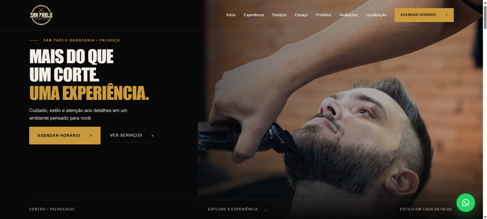

[](https://assisfilipee.github.io/san-pablo-barbearia/)

# San Pablo Barbearia

Site institucional da San Pablo Barbearia, localizada em Palhoça, Santa Catarina. O projeto apresenta a barbearia, seus serviços, produtos e informações de contato, com acesso ao agendamento pelo WhatsApp.

**[Acesse o projeto online](https://assisfilipee.github.io/san-pablo-barbearia/)** — clique também na imagem acima para visitar o site.

## Sobre o projeto

Uma página desenvolvida com HTML, CSS e JavaScript puro, sem frameworks ou dependências de execução. O conteúdo essencial e os links de agendamento permanecem disponíveis sem JavaScript.

### Recursos

- Apresentação da barbearia e da experiência San Pablo.
- Seções de serviços, equipe, produtos e avaliações.
- Localização com mapa integrado e links para rotas.
- Contato e agendamento pelo WhatsApp.
- Menu para dispositivos móveis e navegação por teclado.
- Layout responsivo e animações com suporte à preferência por movimento reduzido.

## Tecnologias

- **HTML5:** estrutura semântica e conteúdo da página.
- **CSS3:** estilos, responsividade e animações.
- **JavaScript:** menu, interações e comportamento das seções.
- **GitHub Pages:** hospedagem da versão online.

## Estrutura

```text
san-pablo-barbearia/
├── assets/
│   ├── css/          # Estilos gerais e por seção
│   ├── img/          # Imagens, logotipo e preview
│   └── js/           # Interações gerais e por seção
├── components/       # Parciais de referência
├── index.html        # Página principal
└── README.md
```

O conteúdo principal está em `index.html`. Os arquivos de `components/` são parciais de referência para futuras páginas; ao editar cabeçalho, rodapé ou ações flutuantes, mantenha essas referências sincronizadas.

## Como executar localmente

1. Clone o repositório:

   ```bash
   git clone https://github.com/assisfilipee/san-pablo-barbearia.git
   ```

2. Acesse a pasta:

   ```bash
   cd san-pablo-barbearia
   ```

3. Abra `index.html` no navegador ou sirva a pasta com um servidor estático de sua preferência.

Não é necessário instalar pacotes nem executar uma etapa de build.

## Configuração

O arquivo `assets/js/main.js` centraliza o número do WhatsApp e os campos opcionais `bookingUrl` e `siteUrl`. Enquanto não houver uma URL específica de agendamento, os botões utilizam o WhatsApp.

Os links de contato também estão presentes no HTML para funcionar sem JavaScript. Ao alterar os dados, revise `index.html` e os parciais correspondentes em `components/`.

## Pontos a revisar

- Definir o domínio definitivo e configurar `canonical`, `og:url` e a URL absoluta de `og:image`.
- Adicionar `sitemap.xml` e `robots.txt` com a URL definitiva.
- Confirmar a nota das avaliações e utilizar somente depoimentos verificados.
- Preencher os horários oficiais e os dados da equipe quando disponíveis.
- Validar a apresentação em diferentes tamanhos de tela, o ponto do mapa e o atendimento pelo WhatsApp em dispositivo real.

## Autor

Desenvolvido por **Filipe Assis**.

[Portfólio](https://www.filipeassis.dev) · [GitHub](https://github.com/assisfilipee)
